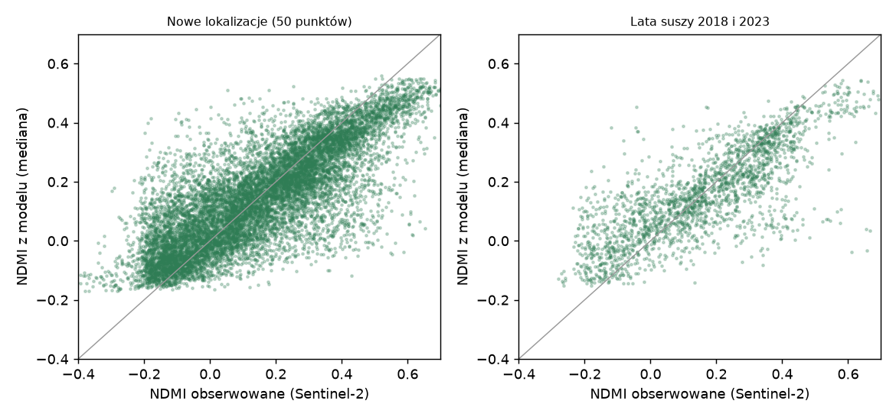

# HydroFusion-PL — wilgotność łanu w dni zachmurzone

> Wytrenowano: 22.11.2026. Wersja modelu: 1.0. Wagi: `artifacts/models/hydrofusion_*` (ok. 2,6 MB).
> Pełne metryki: [`artifacts/validation/hydrofusion_eval.json`](../../artifacts/validation/hydrofusion_eval.json).

## Co robi model

Sentinel-2 nie widzi pola przez chmury (w Polsce ok. 55% dni). Model szacuje wskaźnik wilgotności łanu **NDMI** na dzień analizy, gdy w ostatnich 15 dniach nie ma bezchmurnego zdjęcia działki. Zwraca:
- medianę,
- **przedział 90%**: regresja kwantylowa + konformalne skalibrowanie przedziału,
- **indeks niepodobieństwa DI**: miarę obszaru stosowalności (AoA).

Gdy działka leży poza obszarem stosowalności, model się wyłącza. Serwis wraca wtedy do ścieżki fizycznej i obniża „Pewność danych”.

**Czego model nie robi:** nie rozbija przyczyn niedoboru wody (krok 2). Uprawa w punktach treningowych jest nieznana, więc przyczyny liczy fizyczny bilans FAO-56, który uwzględnia uprawę rolnika (decyzja zespołu, 21.11.2026).

## Dane

| Element | Wartość |
| :--- | :--- |
| Punkty | 100 punktów rolniczych modułu RL (`ml/rl_irrigator/data`): 50 treningowych + 50 kontrolnych (≥ 25 km od treningowych), wszystkie 16 województw |
| Obserwacje | 24 397 bezchmurnych odczytów NDMI (okno 3×3 piksele 20 m, ≥ 6 z 9 pikseli czystych wg SCL), marzec–październik 2018–2026 |
| Satelita | Sentinel-2 L2A Collection 1, Earth Search (AWS), bez konta; NDMI = (B8A − B11)/(B8A + B11), odbicie = DN·scale + offset ze sceny, tak samo jak w serwisie |
| Pogoda | Open-Meteo 2016–2026 z repozytorium RL (bez nowych zapytań do Open-Meteo) |
| Gleba | kategoria IUNG-PIB z punktów RL + SoilGrids v2.0 (98 ze 100 punktów; 2 punkty SoilGrids oznacza jako zabudowę lub wodę) |
| Pobranie | 21–22.11.2026, ok. 63 min (Sentinel-2) i ok. 25 min (SoilGrids) |

**Luka w danych:** w katalogu Earth Search rok 2022 dla Polski ma tylko pojedyncze sceny (113 obserwacji zamiast ok. 3000). Ten rok praktycznie nie wchodzi do treningu.

## Zmienne wejściowe (18)

Zmienne liczą **te same funkcje co serwis** (`hydro_core.features.FEATURES`), na tej samej osi czasu „as-of”. Dzięki temu nie ma rozjazdu między treningiem a działaniem (*training-serving skew*).

| Grupa | Zmienne | Udział w modelu (gain) |
| :--- | :--- | ---: |
| Ostatni bezchmurny odczyt sprzed 16–60 dni | `ndmi_prev`, `ndmi_prev_lag` | 54% |
| NDMI w tym samym terminie poprzednich lat | `ndmi_history_mean` | 17% |
| Gleba | `sand_pct`, `soc_g_kg`, `awc_mm_0_100`, `taw_mm`, `iung_category` | 9% |
| Klimat (opad, ET₀, KBW, dni bez opadu) | `p_15` … `cdd` (9 zmiennych) | 14% |
| Pora roku | `doy` | 6% |

**Świadomie pominięto:**
- zmienne zależne od uprawy (Kc, faza, niedobór wody w glebie), bo uprawa w punktach treningowych jest nieznana,
- teren, bo punkty nie mają NMT 1 m porównywalnego z działką,
- prognozę pogody, bo dla dat historycznych byłoby to zaglądanie w przyszłość.

## Walidacja

Podział jest **po punktach i po latach**, więc model nie widział ani lokalizacji, ani lat, na których go sprawdzono:
- **trening, wczesne zatrzymanie, kalibracja:** 50 punktów treningowych (65 / 15 / 20% punktów), bez lat 2018 i 2023,
- **nowe lokalizacje:** 50 punktów kontrolnych RL, wszystkie lata,
- **lata suszy:** punkty treningowe, lata 2018 i 2023.

| Zbiór sprawdzający | n | RMSE | MAE | R² | Pokrycie 90% (PICP) | Szer. przedziału |
| :--- | ---: | ---: | ---: | ---: | ---: | ---: |
| **Nowe lokalizacje** | 12 175 | **0,133** | 0,099 | **0,62** | 0,89 | 0,45 |
| **Lata suszy 2018, 2023** | 2 229 | **0,131** | 0,095 | **0,61** | 0,91 | 0,47 |

**Porównanie z prostymi metodami (RMSE, nowe lokalizacje):**

| Metoda | RMSE |
| :--- | ---: |
| HydroFusion-PL | **0,133** |
| „Jak na ostatnim bezchmurnym zdjęciu” (16–60 dni) | 0,160 |
| „Jak w tym samym terminie w poprzednich latach” | 0,187 |
| Średnia dla dnia roku | 0,198 |

**Reguła włączenia** (sprawdzana automatycznie w `train.py`): na nowych lokalizacjach model musi mieć RMSE niższe od obu prostych metod, a pokrycie przedziału 90% musi mieścić się w 0,85–0,95. **Spełniona**, więc model jest wdrożony.

**Obszar stosowalności:** 93% obserwacji z nowych lokalizacji leży w AoA. Poza AoA pokrycie przedziału spada do 0,82, dlatego serwis wtedy nie używa modelu.



## Ograniczenia (uczciwie)

- **Cel ze specyfikacji nie jest osiągnięty.** Specyfikacja zakładała R² ≥ 0,78 i RMSE ≤ 0,048; osiągnięto R² ≈ 0,62 i RMSE ≈ 0,13. Główna przyczyna: NDMI zależy mocno od tego, co rośnie i w jakiej fazie, a uprawa w danych treningowych jest nieznana.
- **Szeroki przedział 90%** (ok. ±0,23 NDMI). Wynik w dni zachmurzone to wskazówka, nie pomiar. Interfejs i raport zawsze pokazują go z przedziałem i etykietą „odtworzone modelem”.
- **Model ściąga skrajne wartości do średniej:** zaniża bardzo mokre łany (NDMI > 0,5) i zawyża bardzo suche (< −0,15).
- **Za mało danych:** 100 punktów zamiast planowanych 300–600 i prawie pusty rok 2022.
- **Punkt to nie działka:** trening używa okna 3×3 piksele, serwis średniej z całej działki.

**Jak poprawić:** więcej punktów (skrypty są gotowe), etykieta uprawy z danych ARiMR/LPIS, jeśli będzie dostępna, i NDVI z ostatniego zdjęcia jako dodatkowa zmienna.

## Odtworzenie

```bash
uv sync --group train --group dev
uv run python ml/hydrofusion/fetch_s2_samples.py   # ok. 1 h; bufor w data/cache/hydrofusion/s2
uv run python ml/hydrofusion/fetch_soilgrids.py    # ok. 25 min (limit ISRIC 5 zapytań/min)
uv run python ml/hydrofusion/build_dataset.py      # ok. 6 min
uv run python ml/hydrofusion/train.py              # ok. 30 s; wdraża model tylko po spełnieniu reguły
```

Pobrane próbki (`data/s2_samples.parquet`, `data/dataset.parquet`, `data/soilgrids_points.json`, razem ok. 2,3 MB) są w repozytorium. Sam trening (`train.py`) da się więc powtórzyć bez pobierania danych.

Pełne odtworzenie od zera (`fetch_s2_samples.py`, `build_dataset.py`) wymaga pogody punktów RL w `ml/rl_irrigator/data/weather` i `data/holdout/weather`. Od 22.11.2026 te pliki nie są w repozytorium, a w repozytorium zostają tylko manifesty. Odtwarza je skrypt modułu RL:

```bash
uv run python ml/rl_irrigator/scripts/fetch_training_data.py
uv run python ml/rl_irrigator/scripts/fetch_training_data.py --out-dir data/holdout --grid-offset 0.35 --exclude-manifest data/MANIFEST.json --min-dist-km 25 --forecast-years 2025 2026
```
