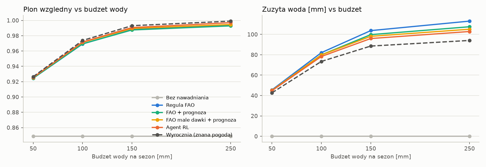
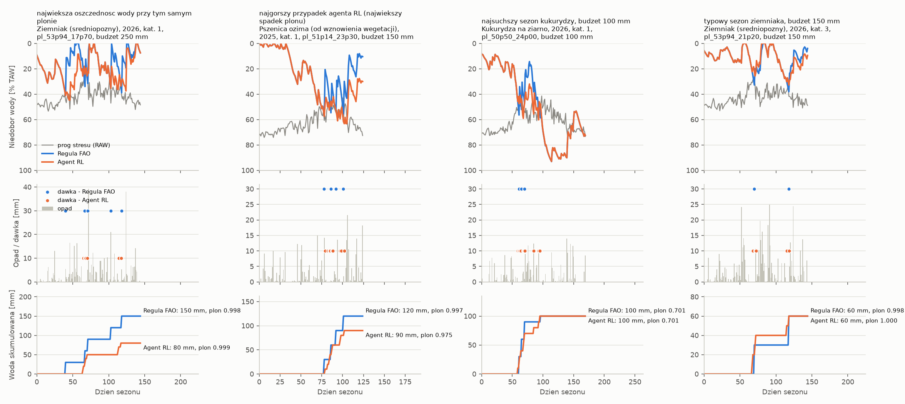

# Ewaluacja agenta RL nawadniania (lata testowe 2025-2026)

Wygenerowano: 2026-11-21T17:07:49 przez `kowr_rl.evaluate`. Liczby pochodza z `artifacts/validation/rl_eval.json`.

**Uwaga (E6):** te lata i punkty byly juz ogladane przy pierwszym tescie (E5). Czysty test E6 to `reports/evaluation_holdout.md`.

**Uklad:** 50 punktow rolnych x lata 2025, 2026 x 4 uprawy x 4 kategorie gleby IUNG x 4 budzety wody = 6400 sezonow na strategie. Kazda strategia dostaje te same dane: pogode z archiwum Open-Meteo i **prawdziwe archiwalne prognozy ECMWF** (wyprzedzenie 1-7 dni; brakujace komorki: 0.29%). Wybrany agent: `E6f_s2@dom` (wybrany na walidacji 2024). Przedzialy: 95% bootstrap po punktach i latach (2000 powtorzen). Przy tylko dwoch latach testowych przedzialy sa szerokie, bo obejmuja niepewnosc miedzy latami.

## Werdykt: agent RL **GOTOWY**

Kryterium z planu: na tescie plon nie gorszy od reguly FAO o wiecej niz 1 pkt proc. przy mniejszym zuzyciu wody albo wyzszy plon przy tym samym budzecie. Sprawdzane lacznie i osobno dla kazdego poziomu budzetu. Zaostrzenie ustalone przed uruchomieniem testu: 'mniej wody' i 'wyzszy plon' musza byc istotne, czyli caly 95% przedzial bootstrap roznicy musi lezec po wlasciwej stronie zera. Sama srednia nie wystarcza. 'Wyzszy plon przy tym samym budzecie' liczy sie tylko wtedy, gdy agent nie zuzywa srednio wiecej wody niz FAO. Inaczej jest to wymiana wody na plon, a nie przewaga.

| Zakres | Delta plonu RL - FAO [pkt proc.] | Delta wody RL - FAO [mm] | Mniej wody, plon >= -1 pkt | Wyzszy plon | Wynik |
|---|---|---|---|---|---|
| wszystkie budzety | +0.23 [+0.14; +0.34] | -5.6 [-6.8; -4.7] | tak | tak | OK |
| 50 mm | +0.11 [+0.06; +0.17] | -0.8 [-1.3; -0.3] | tak | tak | OK |
| 100 mm | +0.25 [+0.09; +0.44] | -3.8 [-5.0; -2.7] | tak | tak | OK |
| 150 mm | +0.28 [+0.13; +0.45] | -7.8 [-9.3; -6.5] | tak | tak | OK |
| 250 mm | +0.28 [+0.24; +0.33] | -10.2 [-12.0; -8.8] | tak | tak | OK |

RL vs **FAO + prognoza** (uczciwszy rywal, ktory tez korzysta z prognozy): delta plonu +0.27 [+0.23; +0.30] pkt proc., delta wody -2.5 [-3.5; -1.5] mm.

RL vs **FAO male dawki + prognoza** (najlepsza prosta regula z E6) - ta sama regula decyzyjna:

| Zakres | Delta plonu [pkt proc.] | Delta wody [mm] | Wynik |
|---|---|---|---|
| wszystkie budzety | +0.10 [+0.09; +0.12] | -1.6 [-2.4; -0.7] | OK |
| 50 mm | +0.02 [+0.01; +0.04] | -0.3 [-0.5; -0.0] | OK |
| 100 mm | +0.04 [+0.01; +0.07] | -1.5 [-2.0; -1.0] | OK |
| 150 mm | +0.12 [+0.09; +0.16] | -2.2 [-3.6; -0.8] | OK |
| 250 mm | +0.24 [+0.18; +0.30] | -2.2 [-3.9; -0.6] | OK |

Sama regula **FAO male dawki + prognoza** vs regula FAO - ta sama regula decyzyjna:

| Zakres | Delta plonu [pkt proc.] | Delta wody [mm] | Wynik |
|---|---|---|---|
| wszystkie budzety | +0.13 [+0.04; +0.23] | -4.1 [-5.6; -2.6] | OK |
| 50 mm | +0.09 [+0.05; +0.14] | -0.5 [-0.9; -0.2] | OK |
| 100 mm | +0.21 [+0.07; +0.39] | -2.2 [-3.5; -1.1] | OK |
| 150 mm | +0.16 [+0.02; +0.31] | -5.6 [-8.1; -3.4] | OK |
| 250 mm | +0.05 [-0.02; +0.10] | -8.0 [-10.5; -5.6] | OK |

Domyslna strategia w module: **`rl`** (`config/rl.yaml`, `default_policy`).

## Wyniki zbiorcze

| Strategia | Plon sredni [95% CI] | Plon min | Plon 5. percentyl | Woda [mm] | Przyrost plonu na 100 mm [pkt proc.] | Dni stresu | Perkolacja [mm] |
|---|---|---|---|---|---|---|---|
| Bez nawadniania | 0.849 [0.808; 0.883] | 0.468 | 0.656 | 0 [0; 0] | - | 48 | 33 |
| Kalendarz | 0.954 [0.938; 0.966] | 0.554 | 0.803 | 138 [138; 138] | 7.6 | 20 | 99 |
| Regula FAO | 0.969 [0.955; 0.980] | 0.563 | 0.842 | 86 [78; 95] | 14.0 | 15 | 39 |
| FAO + prognoza | 0.969 [0.953; 0.980] | 0.563 | 0.842 | 83 [73; 93] | 14.4 | 16 | 38 |
| FAO male dawki + prognoza | 0.970 [0.955; 0.982] | 0.563 | 0.842 | 82 [73; 92] | 14.8 | 16 | 36 |
| Agent RL | 0.971 [0.957; 0.983] | 0.563 | 0.842 | 80 [72; 90] | 15.2 | 14 | 37 |
| Wyrocznia (znana pogoda) | 0.973 [0.958; 0.984] | 0.563 | 0.842 | 75 [64; 86] | 16.7 | 12 | 35 |

**Ziarna losowe agenta RL** (te same sezony testowe):

| Przebieg | Plon | Woda [mm] | Perkolacja [mm] |
|---|---|---|---|
| `E6f_s1@dom` | 0.9704 | 80.7 | 36.3 |
| `E6f_s2@dom` (wybrany) | 0.9712 | 80.5 | 36.5 |
| `E6f_s3@dom` | 0.9702 | 81.9 | 36.4 |

**Odpornosc na rodzaj prognozy:** te same sezony z syntetyczna prognoza z treningu zamiast prawdziwej ECMWF (srednio z 3 ziaren szumu): RL plon 0.9712, woda 80.6 mm; FAO + prognoza plon 0.9687, woda 83.4 mm.

## Wedlug budzetu wody

| Strategia | 50 mm: plon / woda | 100 mm: plon / woda | 150 mm: plon / woda | 250 mm: plon / woda |
|---|---|---|---|---|
| Bez nawadniania | 0.849 / 0 | 0.849 / 0 | 0.849 / 0 | 0.849 / 0 |
| Kalendarz | 0.901 / 50 | 0.945 / 100 | 0.974 / 150 | 0.994 / 250 |
| Regula FAO | 0.924 / 46 | 0.969 / 82 | 0.988 / 104 | 0.994 / 113 |
| FAO + prognoza | 0.925 / 45 | 0.969 / 80 | 0.987 / 100 | 0.993 / 107 |
| FAO male dawki + prognoza | 0.925 / 45 | 0.971 / 80 | 0.989 / 98 | 0.995 / 105 |
| Agent RL | 0.926 / 45 | 0.972 / 78 | 0.991 / 96 | 0.997 / 103 |
| Wyrocznia (znana pogoda) | 0.926 / 43 | 0.974 / 73 | 0.993 / 89 | 0.999 / 94 |

## Wedlug uprawy i kategorii gleby (wszystkie budzety)

| Uprawa | Gleba (TAW) | FAO: plon / woda | Delta plonu RL-FAO [pkt proc.] | Delta wody RL-FAO [mm] | Sezony z RL gorszym o >1 pkt |
|---|---|---|---|---|---|
| Kukurydza na ziarno | 1 (110 mm) | 0.938 / 104 | +0.45 | -6.0 | 0% |
| Kukurydza na ziarno | 2 (150 mm) | 0.964 / 88 | +0.32 | -2.0 | 0% |
| Kukurydza na ziarno | 3 (185 mm) | 0.979 / 75 | +0.29 | -0.0 | 0% |
| Kukurydza na ziarno | 4 (220 mm) | 0.987 / 61 | +0.28 | +4.7 | 0% |
| Ziemniak (sredniopozny) | 1 (110 mm) | 0.924 / 119 | +0.61 | -9.8 | 0% |
| Ziemniak (sredniopozny) | 2 (150 mm) | 0.951 / 108 | +0.32 | -6.5 | 0% |
| Ziemniak (sredniopozny) | 3 (185 mm) | 0.965 / 100 | +0.26 | -5.2 | 0% |
| Ziemniak (sredniopozny) | 4 (220 mm) | 0.975 / 91 | +0.26 | -3.6 | 0% |
| Pszenica ozima (od wznowienia wegetacji) | 1 (110 mm) | 0.957 / 98 | -0.16 | -12.2 | 6% |
| Pszenica ozima (od wznowienia wegetacji) | 2 (150 mm) | 0.976 / 86 | +0.02 | -12.9 | 2% |
| Pszenica ozima (od wznowienia wegetacji) | 3 (185 mm) | 0.986 / 75 | +0.13 | -12.2 | 1% |
| Pszenica ozima (od wznowienia wegetacji) | 4 (220 mm) | 0.991 / 63 | +0.22 | -10.9 | 0% |
| Burak cukrowy | 1 (110 mm) | 0.957 / 100 | +0.20 | -7.9 | 3% |
| Burak cukrowy | 2 (150 mm) | 0.975 / 84 | +0.16 | -5.2 | 0% |
| Burak cukrowy | 3 (185 mm) | 0.985 / 69 | +0.18 | -1.4 | 0% |
| Burak cukrowy | 4 (220 mm) | 0.992 / 56 | +0.18 | +1.1 | 0% |

## Przykladowe sezony: agent RL vs regula FAO

Gorny panel: niedobor wody w strefie korzeniowej (% TAW, wyzej = wilgotniej) i prog stresu RAW. Srodkowy: opad (szary) i dawki obu strategii. Dolny: woda skumulowana z plonem koncowym. Jeden z przykladow to celowo **najgorszy** przypadek agenta.

## Ograniczenia ewaluacji

- Plon to wynik modelu FAO-33 (jedna wartosc Ky na sezon), a nie pomiar polowy. Model nie rozroznia wrazliwosci faz rozwoju.
- Tylko dwa lata testowe, wiec niepewnosc miedzy latami jest duza (szerokie przedzialy).
- Kategorie gleby sa liczone w ukladzie czynnikowym (kazdy punkt w kazdej kategorii), wiec nie odpowiadaja rzeczywistemu rozkladowi gleb.
- Parametry upraw i TAW sa do weryfikacji z mentorem. Pogoda pochodzi z reanalizy na siatce ok. 9-25 km.
- Brak podsiaku wod gruntowych i splywu powierzchniowego w bilansie (model jednowarstwowy).

