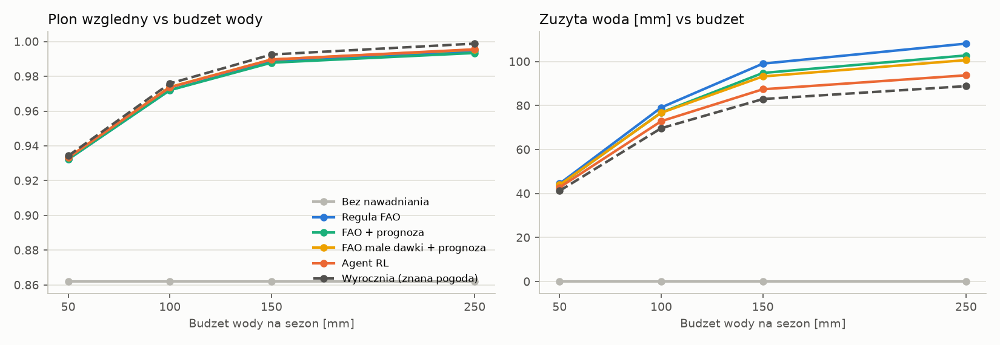

# Ewaluacja agenta RL nawadniania: CZYSTY TEST na nowych lokalizacjach (holdout, lata 2025-2026)

Wygenerowano: 2026-11-21T20:03:49 przez `kowr_rl.evaluate`. Liczby pochodza z `artifacts/validation/rl_eval_holdout.json`.

**Zestaw holdout (E6):** 50 nowych punktow rolnych z siatki przesunietej o 0,35 st. (>= 25 km od kazdego punktu treningowego), nieuzywanych ani w treningu, ani przy wyborze modelu (protokol: PLAN.md, sekcja 5).

**Uklad:** 50 punktow rolnych x lata 2025, 2026 x 4 uprawy x 4 kategorie gleby IUNG x 4 budzety wody = 24000 sezonow na strategie. Kazda strategia dostaje te same dane: pogode z archiwum Open-Meteo i **prawdziwe archiwalne prognozy ECMWF** (wyprzedzenie 1-7 dni; brakujace komorki: 0.38%). Wybrany agent: `E6f_s2@dom` (wybrany na walidacji 2024). Przedzialy: 95% bootstrap po punktach i latach (2000 powtorzen).

## Werdykt: agent RL **GOTOWY**

Kryterium z planu: na tescie plon nie gorszy od reguly FAO o wiecej niz 1 pkt proc. przy mniejszym zuzyciu wody albo wyzszy plon przy tym samym budzecie. Sprawdzane lacznie i osobno dla kazdego poziomu budzetu. Zaostrzenie ustalone przed uruchomieniem testu: 'mniej wody' i 'wyzszy plon' musza byc istotne, czyli caly 95% przedzial bootstrap roznicy musi lezec po wlasciwej stronie zera. Sama srednia nie wystarcza. 'Wyzszy plon przy tym samym budzecie' liczy sie tylko wtedy, gdy agent nie zuzywa srednio wiecej wody niz FAO. Inaczej jest to wymiana wody na plon, a nie przewaga.

| Zakres | Delta plonu RL - FAO [pkt proc.] | Delta wody RL - FAO [mm] | Mniej wody, plon >= -1 pkt | Wyzszy plon | Wynik |
|---|---|---|---|---|---|
| wszystkie budzety | +0.12 [+0.05; +0.19] | -8.5 [-9.9; -7.3] | tak | tak | OK |
| 50 mm | +0.10 [+0.07; +0.13] | -1.7 [-2.4; -1.1] | tak | tak | OK |
| 100 mm | +0.16 [+0.05; +0.28] | -6.2 [-8.1; -4.5] | tak | tak | OK |
| 150 mm | +0.12 [+0.02; +0.22] | -11.6 [-13.7; -9.7] | tak | tak | OK |
| 250 mm | +0.10 [+0.04; +0.14] | -14.4 [-16.1; -13.0] | tak | tak | OK |

RL vs **FAO + prognoza** (uczciwszy rywal, ktory tez korzysta z prognozy): delta plonu +0.16 [+0.13; +0.19] pkt proc., delta wody -5.3 [-6.0; -4.8] mm.

RL vs **FAO male dawki + prognoza** (najlepsza prosta regula z E6) - ta sama regula decyzyjna:

| Zakres | Delta plonu [pkt proc.] | Delta wody [mm] | Wynik |
|---|---|---|---|
| wszystkie budzety | +0.00 [-0.02; +0.02] | -4.4 [-5.3; -3.7] | OK |
| 50 mm | -0.00 [-0.01; +0.01] | -1.1 [-1.8; -0.6] | OK |
| 100 mm | -0.02 [-0.05; +0.02] | -3.8 [-5.0; -2.6] | OK |
| 150 mm | -0.00 [-0.04; +0.03] | -5.8 [-7.0; -4.7] | OK |
| 250 mm | +0.02 [-0.02; +0.07] | -6.9 [-7.9; -5.9] | OK |

Sama regula **FAO male dawki + prognoza** vs regula FAO - ta sama regula decyzyjna:

| Zakres | Delta plonu [pkt proc.] | Delta wody [mm] | Wynik |
|---|---|---|---|
| wszystkie budzety | +0.12 [+0.06; +0.18] | -4.1 [-5.0; -3.2] | OK |
| 50 mm | +0.10 [+0.07; +0.12] | -0.6 [-1.0; -0.2] | OK |
| 100 mm | +0.17 [+0.09; +0.27] | -2.4 [-3.4; -1.6] | OK |
| 150 mm | +0.13 [+0.05; +0.21] | -5.8 [-7.2; -4.6] | OK |
| 250 mm | +0.07 [+0.02; +0.12] | -7.5 [-9.1; -6.2] | OK |

Domyslna strategia w module: **`rl`** (`config/rl.yaml`, `default_policy`).

## Wyniki zbiorcze

| Strategia | Plon sredni [95% CI] | Plon min | Plon 5. percentyl | Woda [mm] | Przyrost plonu na 100 mm [pkt proc.] | Dni stresu | Perkolacja [mm] |
|---|---|---|---|---|---|---|---|
| Bez nawadniania | 0.862 [0.826; 0.892] | 0.457 | 0.663 | 0 [0; 0] | - | 48 | 29 |
| Kalendarz | 0.958 [0.946; 0.969] | 0.556 | 0.811 | 135 [135; 135] | 7.1 | 19 | 94 |
| Regula FAO | 0.972 [0.960; 0.982] | 0.556 | 0.847 | 83 [74; 92] | 13.3 | 15 | 36 |
| FAO + prognoza | 0.971 [0.959; 0.982] | 0.556 | 0.847 | 80 [71; 89] | 13.8 | 16 | 34 |
| FAO male dawki + prognoza | 0.973 [0.961; 0.983] | 0.556 | 0.848 | 79 [70; 88] | 14.1 | 16 | 33 |
| Agent RL | 0.973 [0.961; 0.983] | 0.556 | 0.848 | 74 [65; 85] | 15.0 | 15 | 32 |
| Wyrocznia (znana pogoda) | 0.975 [0.963; 0.985] | 0.556 | 0.849 | 71 [61; 82] | 16.0 | 12 | 31 |

**Ziarna losowe agenta RL** (te same sezony testowe):

| Przebieg | Plon | Woda [mm] | Perkolacja [mm] |
|---|---|---|---|
| `E6f_s2@dom` (wybrany) | 0.9730 | 74.2 | 32.2 |
| `E7_s2@domc` | 0.9729 | 77.2 | 33.1 |

**Odpornosc na rodzaj prognozy:** te same sezony z syntetyczna prognoza z treningu zamiast prawdziwej ECMWF (srednio z 3 ziaren szumu): RL plon 0.9730, woda 74.5 mm; FAO + prognoza plon 0.9715, woda 80.0 mm.

## Wedlug budzetu wody

| Strategia | 50 mm: plon / woda | 100 mm: plon / woda | 150 mm: plon / woda | 250 mm: plon / woda |
|---|---|---|---|---|
| Bez nawadniania | 0.862 / 0 | 0.862 / 0 | 0.862 / 0 | 0.862 / 0 |
| Kalendarz | 0.910 / 50 | 0.953 / 100 | 0.977 / 149 | 0.994 / 241 |
| Regula FAO | 0.932 / 45 | 0.972 / 79 | 0.988 / 99 | 0.995 / 108 |
| FAO + prognoza | 0.932 / 44 | 0.972 / 77 | 0.988 / 95 | 0.993 / 103 |
| FAO male dawki + prognoza | 0.933 / 44 | 0.974 / 77 | 0.990 / 93 | 0.995 / 101 |
| Agent RL | 0.933 / 43 | 0.974 / 73 | 0.990 / 87 | 0.996 / 94 |
| Wyrocznia (znana pogoda) | 0.934 / 41 | 0.976 / 70 | 0.993 / 83 | 0.999 / 89 |

## Wedlug uprawy (wszystkie gleby i budzety)

| Uprawa | FAO: plon / woda | Delta plonu RL-FAO [pkt proc.] | Delta wody RL-FAO [mm] |
|---|---|---|---|
| Kukurydza na ziarno | 0.965 / 83 | +0.32 | -1.5 |
| Ziemniak (sredniopozny) | 0.952 / 105 | +0.38 | -6.6 |
| Pszenica ozima (od wznowienia wegetacji) | 0.976 / 80 | +0.05 | -11.8 |
| Burak cukrowy | 0.976 / 79 | +0.16 | -4.4 |
| Zboza jare (jeczmien, pszenica jara) | 0.972 / 81 | +0.25 | -9.7 |
| Kukurydza na kiszonke | 0.968 / 81 | +0.31 | -3.5 |
| Rzepak ozimy (od wznowienia wegetacji) | 0.982 / 68 | -0.30 | -16.4 |
| Rosliny straczkowe (groch, bobik na nasiona) | 0.975 / 85 | +0.19 | -12.1 |
| Warzywa gruntowe (kapustne) | 0.984 / 71 | +0.10 | -6.1 |
| Chmiel | 0.983 / 74 | -0.06 | -11.3 |
| Tyton | 0.988 / 63 | -0.08 | -11.6 |
| Drzewa owocowe (sad jabloniowy) | 0.927 / 112 | +0.22 | -0.2 |
| Krzewy owocowe (porzeczka, malina) | 0.974 / 85 | +0.12 | -5.9 |
| Truskawki | 0.983 / 92 | +0.04 | -21.5 |
| Laki i pastwiska | 0.971 / 81 | +0.04 | -5.2 |

## Wedlug uprawy i kategorii gleby (wszystkie budzety)

| Uprawa | Gleba (TAW) | FAO: plon / woda | Delta plonu RL-FAO [pkt proc.] | Delta wody RL-FAO [mm] |
|---|---|---|---|---|
| Kukurydza na ziarno | 1 (110 mm) | 0.935 / 105 | +0.43 | -6.9 |
| Kukurydza na ziarno | 2 (150 mm) | 0.963 / 89 | +0.29 | -2.7 |
| Kukurydza na ziarno | 3 (185 mm) | 0.977 / 75 | +0.29 | +0.8 |
| Kukurydza na ziarno | 4 (220 mm) | 0.986 / 64 | +0.29 | +2.9 |
| Ziemniak (sredniopozny) | 1 (110 mm) | 0.921 / 119 | +0.73 | -9.8 |
| Ziemniak (sredniopozny) | 2 (150 mm) | 0.949 / 109 | +0.31 | -7.0 |
| Ziemniak (sredniopozny) | 3 (185 mm) | 0.964 / 101 | +0.25 | -6.1 |
| Ziemniak (sredniopozny) | 4 (220 mm) | 0.974 / 92 | +0.25 | -3.5 |
| Pszenica ozima (od wznowienia wegetacji) | 1 (110 mm) | 0.955 / 97 | -0.19 | -11.8 |
| Pszenica ozima (od wznowienia wegetacji) | 2 (150 mm) | 0.975 / 86 | +0.01 | -12.3 |
| Pszenica ozima (od wznowienia wegetacji) | 3 (185 mm) | 0.984 / 75 | +0.18 | -11.8 |
| Pszenica ozima (od wznowienia wegetacji) | 4 (220 mm) | 0.990 / 64 | +0.21 | -11.4 |
| Burak cukrowy | 1 (110 mm) | 0.955 / 100 | +0.19 | -8.7 |
| Burak cukrowy | 2 (150 mm) | 0.974 / 85 | +0.13 | -5.2 |
| Burak cukrowy | 3 (185 mm) | 0.985 / 73 | +0.15 | -4.0 |
| Burak cukrowy | 4 (220 mm) | 0.991 / 58 | +0.18 | +0.5 |
| Zboza jare (jeczmien, pszenica jara) | 1 (110 mm) | 0.947 / 98 | +0.07 | -10.4 |
| Zboza jare (jeczmien, pszenica jara) | 2 (150 mm) | 0.970 / 87 | +0.29 | -9.8 |
| Zboza jare (jeczmien, pszenica jara) | 3 (185 mm) | 0.982 / 76 | +0.32 | -10.4 |
| Zboza jare (jeczmien, pszenica jara) | 4 (220 mm) | 0.989 / 63 | +0.34 | -8.3 |
| Kukurydza na kiszonke | 1 (110 mm) | 0.939 / 104 | +0.40 | -8.8 |
| Kukurydza na kiszonke | 2 (150 mm) | 0.965 / 87 | +0.27 | -4.7 |
| Kukurydza na kiszonke | 3 (185 mm) | 0.979 / 74 | +0.28 | -2.0 |
| Kukurydza na kiszonke | 4 (220 mm) | 0.988 / 61 | +0.28 | +1.4 |
| Rzepak ozimy (od wznowienia wegetacji) | 1 (110 mm) | 0.964 / 90 | -0.68 | -16.1 |
| Rzepak ozimy (od wznowienia wegetacji) | 2 (150 mm) | 0.981 / 76 | -0.32 | -17.1 |
| Rzepak ozimy (od wznowienia wegetacji) | 3 (185 mm) | 0.990 / 62 | -0.14 | -16.9 |
| Rzepak ozimy (od wznowienia wegetacji) | 4 (220 mm) | 0.994 / 47 | -0.04 | -15.2 |
| Rosliny straczkowe (groch, bobik na nasiona) | 1 (110 mm) | 0.956 / 99 | +0.02 | -12.9 |
| Rosliny straczkowe (groch, bobik na nasiona) | 2 (150 mm) | 0.973 / 89 | +0.20 | -12.3 |
| Rosliny straczkowe (groch, bobik na nasiona) | 3 (185 mm) | 0.982 / 80 | +0.25 | -11.8 |
| Rosliny straczkowe (groch, bobik na nasiona) | 4 (220 mm) | 0.988 / 72 | +0.30 | -11.3 |
| Warzywa gruntowe (kapustne) | 1 (110 mm) | 0.969 / 93 | +0.12 | -10.9 |
| Warzywa gruntowe (kapustne) | 2 (150 mm) | 0.983 / 77 | +0.08 | -7.6 |
| Warzywa gruntowe (kapustne) | 3 (185 mm) | 0.990 / 64 | +0.10 | -4.5 |
| Warzywa gruntowe (kapustne) | 4 (220 mm) | 0.994 / 51 | +0.10 | -1.2 |
| Chmiel | 1 (110 mm) | 0.967 / 95 | -0.19 | -14.0 |
| Chmiel | 2 (150 mm) | 0.982 / 79 | -0.10 | -12.2 |
| Chmiel | 3 (185 mm) | 0.989 / 66 | +0.01 | -9.2 |
| Chmiel | 4 (220 mm) | 0.994 / 55 | +0.05 | -9.9 |
| Tyton | 1 (110 mm) | 0.976 / 86 | -0.22 | -15.3 |
| Tyton | 2 (150 mm) | 0.988 / 68 | -0.12 | -12.1 |
| Tyton | 3 (185 mm) | 0.993 / 55 | +0.01 | -10.6 |
| Tyton | 4 (220 mm) | 0.997 / 42 | +0.02 | -8.2 |
| Drzewa owocowe (sad jabloniowy) | 1 (110 mm) | 0.893 / 124 | +0.33 | -3.8 |
| Drzewa owocowe (sad jabloniowy) | 2 (150 mm) | 0.921 / 116 | +0.18 | -1.6 |
| Drzewa owocowe (sad jabloniowy) | 3 (185 mm) | 0.940 / 107 | +0.17 | +1.1 |
| Drzewa owocowe (sad jabloniowy) | 4 (220 mm) | 0.955 / 99 | +0.21 | +3.5 |
| Krzewy owocowe (porzeczka, malina) | 1 (110 mm) | 0.954 / 103 | +0.10 | -8.9 |
| Krzewy owocowe (porzeczka, malina) | 2 (150 mm) | 0.972 / 89 | +0.09 | -6.5 |
| Krzewy owocowe (porzeczka, malina) | 3 (185 mm) | 0.982 / 79 | +0.14 | -5.0 |
| Krzewy owocowe (porzeczka, malina) | 4 (220 mm) | 0.989 / 67 | +0.15 | -3.1 |
| Truskawki | 1 (110 mm) | 0.967 / 109 | +0.37 | -24.6 |
| Truskawki | 2 (150 mm) | 0.983 / 97 | -0.06 | -23.8 |
| Truskawki | 3 (185 mm) | 0.989 / 86 | -0.10 | -20.8 |
| Truskawki | 4 (220 mm) | 0.992 / 75 | -0.05 | -16.8 |
| Laki i pastwiska | 1 (110 mm) | 0.949 / 103 | -0.05 | -9.2 |
| Laki i pastwiska | 2 (150 mm) | 0.968 / 86 | +0.02 | -5.2 |
| Laki i pastwiska | 3 (185 mm) | 0.980 / 74 | +0.09 | -3.8 |
| Laki i pastwiska | 4 (220 mm) | 0.988 / 61 | +0.11 | -2.5 |

## Przykladowe sezony: agent RL vs regula FAO

Gorny panel: niedobor wody w strefie korzeniowej (% TAW, wyzej = wilgotniej) i prog stresu RAW. Srodkowy: opad (szary) i dawki obu strategii. Dolny: woda skumulowana z plonem koncowym.

## Zalozenia ewaluacji

- Wszystkie strategie sa liczone tym samym bilansem FAO-56 i ta sama funkcja plonu FAO-33, na tych samych danych pogodowych i prognozach.
- Uklad czynnikowy: kazdy punkt w kazdej kategorii gleby IUNG-PIB, zeby porownac strategie na wszystkich glebach.
- Parametry upraw z FAO-56/33 (`config/crops.yaml`), pojemnosc wodna gleby z kategorii IUNG-PIB (`config/soils.yaml`).

